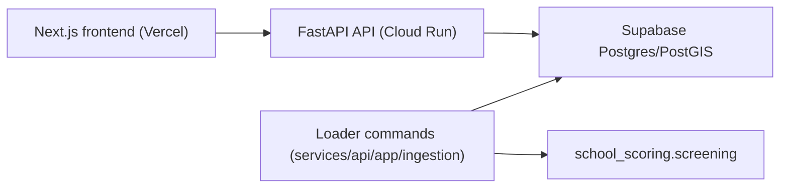

# RISE-PNG architecture

## Goal

A decision-support application for ADB staff to screen secondary schools in Papua New Guinea.
It shows a ranked list and a map, explains why a school sits where it does, and compares rules.
The API also serves exports of the list.
The application reads results that were computed and stored when a set of inputs was loaded.

## System overview



- `apps/web` is the screening workspace.
  `/` redirects to `/screening` and keeps the query string.
  The map uses deck.gl on MapLibre.
  Browser calls go to the same origin under `/api/v1/` and Next forwards them to the API.
- `services/api` serves the stored runs under `/api/v1/screening`: rules, input versions, ranked results, school detail, rule comparison and CSV and XLSX exports.
  It reads the database and recomputes nothing.
- `packages/school_scoring` holds the screening engine.
  It runs inside the loader commands, not in a request.
- Supabase Postgres/PostGIS stores the inputs, the runs and the results.
- Sign-in uses Supabase email magic links (see `authentication.md`), and the API checks the token on every request (see `api-security.md`).

## Repository structure

```text
apps/
  web/                    Next.js application
services/
  api/                    FastAPI application and loader commands
packages/
  school_scoring/         Screening engine
infra/
  sql/                    Migrations, applied in file order
  cloud-run/              Deployment notes for the API
  vercel/                 Deployment notes for the frontend
docs/
  architecture.md
```

## Data model

`schools`
- one row per school, loaded from the curated school table by `python -m app.ingestion.load_core_data`
- `school_id` is a generated UUID, `school_name_norm` is the unique join key, and `geom` is a point in EPSG:4326
- the screening API reads `school_id` and the coordinates from it

`screening_input_versions`, `screening_inputs`
- one frozen input version and the school records of that version, stored by `python -m app.ingestion.load_screening_inputs`
- `screening_inputs.school_id` links a record to `schools` through `normalize_join_key` when the name matches one school

`screening_runs`, `screening_results`
- one run per rule and engine package version, and one result row per school and run

`screening_persistence_*`
- the stored top-20 persistence numbers of a recorded experiment, attached to a version when it is created

The tables have row level security on and no privileges for `anon` or `authenticated`.
`services/api/README.md` describes the loaders, the routes and the rules the responses follow.

## Join and coordinate rules

- Text joins use `normalize_join_key`: lowercase, trimmed, with whitespace collapsed.
- Coordinates are stored in EPSG:4326.
- A school name that matches no school or several leaves `school_id` null, and the loader lists the name.

## Deployment

- Vercel hosts `apps/web`.
- Cloud Run hosts `services/api`, built from `services/api/Dockerfile`.
- Supabase hosts Postgres/PostGIS.
  Migrations in `infra/sql` are applied in file order, and the application never changes the schema.
